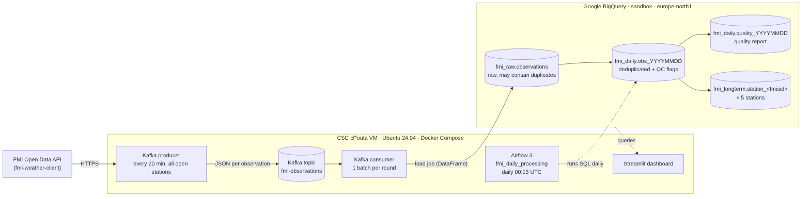

# FMI weather data pipeline

ELT pipeline for Finnish Meteorological Institute (FMI) weather observations:

**FMI API → Kafka producer → Kafka → consumer → BigQuery (raw) → Airflow (daily dedup + quality checks → daily and long-term tables) → Streamlit**

Everything except BigQuery runs with Docker Compose on one CSC cPouta VM.



| Document | Contents |
|---|---|
| [docs/architecture.md](docs/architecture.md) | Data model, processing steps, Airflow DAG plan, design decisions |
| [docs/csc-setup.md](docs/csc-setup.md) | CSC cPouta configuration: VM, security group, SSH tunnel, secrets, teardown |
| [docs/video-script.md](docs/video-script.md) | 5-minute walkthrough outline |

## Repository layout

```
app/                      Producer, consumer, dashboard (one Docker image)
  fmi_pipeline/
    producer.py           FMI API -> Kafka (rate-limited, discovers active stations)
    consumer.py           Kafka -> BigQuery, one load job per batch
    fmi_client.py         wrapper around fmi-weather-client
    bq.py                 raw table schema, BigQuery helpers
    bq_check.py           setup check (free metadata + dry-run queries)
  dashboard/app.py        Streamlit app
airflow/dags/
  fmi_daily_processing.py Airflow 3 DAG
  fmi_bq/sql/*.sql        BigQuery SQL: daily table, quality report, long-term merge
data/FMI_stations.csv     station list from the course material
scripts/
  setup_vm.sh             Docker + swap on a fresh Ubuntu 24.04 VM
  init_env.sh             creates .env with generated secrets
tests/                    offline tests (FMI responses, Kafka and BigQuery are faked)
docker-compose.yml
```

## Prerequisites

- CSC project with cPouta, a `standard.large` Ubuntu 24.04 VM reachable with `ssh cpouta` (see [docs/csc-setup.md](docs/csc-setup.md))
- Google Cloud project in the **BigQuery sandbox** (no billing account) with datasets `fmi_raw`, `fmi_daily`, `fmi_longterm` in `europe-north1`
- Service-account key (roles BigQuery Data Editor + BigQuery Job User) at `~/secrets/gcp-key.json` on the VM, `chmod 600`

## Run it on the VM

```bash
ssh cpouta
git clone https://github.com/<your-user>/fmi-pipeline.git
cd fmi-pipeline
bash scripts/setup_vm.sh          # once: Docker, Compose, swap
exit                              # log in again so the docker group applies

ssh cpouta
cd fmi-pipeline
scripts/init_env.sh               # creates .env with generated secrets
nano .env                         # check GCP_PROJECT_ID (must be the project *ID*)

docker compose build
docker compose run --rm --no-deps consumer python -m fmi_pipeline.bq_check   # verifies BigQuery access
docker compose up -d
docker compose ps                 # kafka-init and airflow-init show "exited (0)", others "running"/"healthy"
```

While `ssh cpouta` is connected, open on your laptop:

- Airflow: <http://localhost:8080>, user `admin`, password `AIRFLOW_ADMIN_PASSWORD` from `.env` (`grep ADMIN_PASSWORD .env`)
- Dashboard: <http://localhost:8501>

## Watch it work

```bash
docker compose logs -f producer consumer
```

The producer's first round checks all 478 open stations (about 5 minutes at 1.5 requests/s). Many of
them are not weather stations and are marked inactive ("no_data"); this is expected. After that, each
round polls only active stations and logs an estimate of daily FMI requests. The consumer logs one
line per BigQuery load.

Kafka:

```bash
# a few messages from the topic
docker compose exec kafka /opt/kafka/bin/kafka-console-consumer.sh \
  --bootstrap-server localhost:9092 --topic fmi-observations --from-beginning --max-messages 3
# consumer group position and lag
docker compose exec kafka /opt/kafka/bin/kafka-consumer-groups.sh \
  --bootstrap-server localhost:9092 --describe --group fmi-bigquery-loader
```

BigQuery (console or `bq`), raw data of today:

```sql
SELECT fmisid, station_name, obs_time, temperature, humidity
FROM `fmi-pipeline.fmi_raw.observations`
WHERE obs_time >= TIMESTAMP(CURRENT_DATE())   -- the partition filter is required
ORDER BY obs_time DESC
LIMIT 20;
```

## Daily processing (Airflow)

The DAG `fmi_daily_processing` runs at 00:15 UTC and processes the previous UTC day. To demonstrate
it without waiting a day, trigger it for today (in the UI: *Trigger* → config `{"day": "YYYY-MM-DD"}`),
or from the VM:

```bash
docker compose exec airflow-scheduler airflow dags trigger fmi_daily_processing -c "{\"day\": \"$(date -u +%F)\"}"
```

Outputs: `fmi_daily.obs_YYYYMMDD`, `fmi_daily.quality_YYYYMMDD`, and `fmi_longterm.station_<fmisid>`
for the five stations in `LONGTERM_STATIONS`. Re-running a day replaces its results.

## Costs (zero by design)

- **BigQuery sandbox**: no billing account is linked, so nothing can be charged. Writes use free load
  jobs (no streaming, no DML). Limits: 10 GiB storage over the project's lifetime, 1 TiB queries/month,
  tables expire after 60 days. This pipeline stores a few MB per day.
- Every query has `maximum_bytes_billed` = 1 GB (`BQ_MAX_BYTES_BILLED`), the raw table requires a
  partition filter, and dashboard queries are cached for 5 minutes.
- **CSC**: billing units from the academic project, about 55 BU/day. A stopped VM still consumes BUs;
  delete it when done ([teardown](docs/csc-setup.md#7-teardown-after-grading)).
- **FMI**: free open data; the producer stays under the 20 000 requests/day limit.

## Tests (optional, on your laptop)

```bash
python3 -m venv .venv && source .venv/bin/activate
pip install -r app/requirements.txt -r requirements-dev.txt
pytest
```

The tests use a recorded-format FMI response, fake Kafka objects, and a DuckDB-backed stand-in for
BigQuery (SQL translated with sqlglot) to check deduplication, QC flags, the quality report and the
long-term merge. `tests/test_dag.py` also runs the whole DAG with `dag.test()` if Apache Airflow 3.3
is installed (otherwise it is skipped).

## Troubleshooting

| Symptom | Fix |
|---|---|
| `bind source path does not exist` | `GCP_KEY_FILE` in `.env` points to a missing file |
| `Permission denied` reading the key | key must be owned by `ubuntu` (uid 1000) with mode 600 |
| `Not found: Dataset` / location error | create the datasets in `europe-north1`, or set `BQ_LOCATION` to their location; run `bq_check` |
| Query rejected because of `maximumBytesBilled` | set `BQ_MAX_BYTES_BILLED=0` in `.env`, then `docker compose up -d` |
| Producer warns about the FMI request limit | increase `POLL_INTERVAL_MINUTES` in `.env` |
| `toomanyrequests` when pulling images | `docker login` with a free Docker Hub account |
| Airflow task fails with an auth/JWT error | secrets must be identical in all Airflow containers: `docker compose up -d --force-recreate` |
| `check_raw_data` fails | no raw data for that day: check `docker compose logs consumer` |
