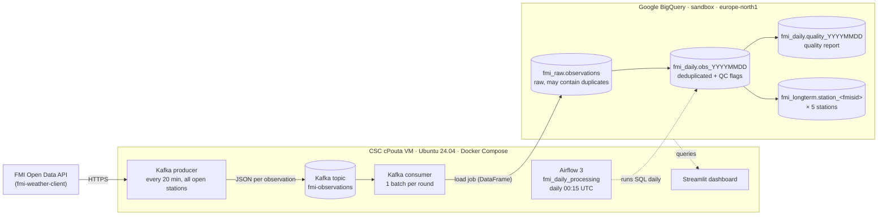
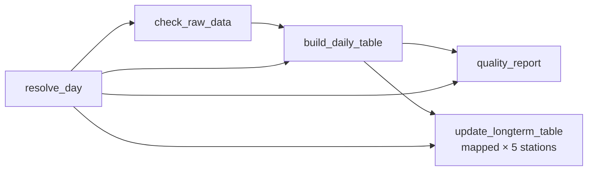

# Data model and pipeline plan

## End-to-end architecture

ELT: raw data is loaded into BigQuery first, and all transformations run inside BigQuery as SQL.

## Processing steps

| # | Step | Runs where / when | Input → output | Notes |
|---|------|-------------------|----------------|-------|
| 1 | **Extract**: Kafka producer | `producer` container, every 20 min at hh:08, hh:28, hh:48 UTC | FMI API → topic `fmi-observations` | Polls all 478 open stations from `FMI_stations.csv` once, then only those that return weather data (inactive ones are re-checked every 24 h). Each request returns the last 20 minutes, i.e. two 10-minute observations. |
| 2 | **Load**: Kafka consumer | `consumer` container, continuous | topic → `fmi_raw.observations` | Buffers one producer round (≈200 stations × 2 observations) into a pandas DataFrame and appends it with one BigQuery load job. Kafka offsets are committed only after BigQuery accepted the batch. |
| 3 | **Transform 1**: daily table | Airflow task `build_daily_table`, daily | raw (one UTC day) → `fmi_daily.obs_YYYYMMDD` | Removes duplicates on `(fmisid, obs_time)`, adds quality-check flags. |
| 4 | **Quality report** | Airflow task `quality_report` | daily table + raw → `fmi_daily.quality_YYYYMMDD` | One row per station: duplicates removed, completeness %, longest gap, missing values, flagged outliers. |
| 5 | **Transform 2**: long-term tables | Airflow task `update_longterm_table` × 5 (mapped) | daily table + existing history → `fmi_longterm.station_<fmisid>` | Merges the new day into each station's history; re-processing a day replaces it. |
| 6 | **Visualise** | `dashboard` container (Streamlit) | raw / quality / long-term tables | Map of latest observations, recent records of the 5 stations, daily QC report, long-term line charts. |

## Airflow DAG `fmi_daily_processing`

- **Schedule**: `CronTriggerTimetable("15 0 * * *", UTC)`: processes the previous UTC day, 15 minutes after midnight so the last observations of the day have arrived.
- **Manual runs**: trigger with config `{"day": "YYYY-MM-DD"}` to (re)process any day, including today (handy for the demo).
- **Idempotent**: every task writes its output with `WRITE_TRUNCATE`, so re-running a day gives the same result.
- **Retries**: 2 retries, 5 minutes apart. `check_raw_data` fails the run if the day has no raw data (pipeline down).

## Data model

### `fmi_raw.observations` (raw, append-only)

Partitioned by `DATE(obs_time)`, clustered by `fmisid`, **partition filter required**: every query must filter on `obs_time`.

| Column | Type | Description |
|---|---|---|
| fmisid | INT64 (required) | FMI station id |
| station_name, latitude, longitude | STRING, FLOAT64 | From the FMI response |
| obs_time | TIMESTAMP (required) | Observation time, UTC |
| temperature, dew_point | FLOAT64 | °C |
| humidity | FLOAT64 | % |
| pressure | FLOAT64 | hPa, sea level |
| wind_speed, wind_gust | FLOAT64 | m/s |
| wind_direction | FLOAT64 | degrees |
| cloud_cover | FLOAT64 | oktas 0–8 (9 = sky obscured) |
| precipitation_1h | FLOAT64 | mm in the last hour |
| fetched_at, round_id | TIMESTAMP, STRING | When / in which polling round the producer fetched it |
| kafka_partition, kafka_offset | INT64 | Lineage back to the Kafka message |
| ingested_at | TIMESTAMP | When the consumer loaded the batch |

### `fmi_daily.obs_YYYYMMDD` (one table per day, all stations)

Same measurement columns as raw (one row per station and observation time), plus:

| Column | Meaning |
|---|---|
| missing_core_params | How many of temperature, humidity, dew point, pressure, wind speed are missing |
| qc_temperature_range | Temperature outside −55…+40 °C |
| qc_humidity_range | Humidity outside 0…100 % |
| qc_pressure_range | Pressure outside 900…1080 hPa |
| qc_wind_range | Wind speed outside 0…50 m/s or gust outside 0…75 m/s |
| qc_dew_point_above_temperature | Dew point more than 1 °C above air temperature (physically implausible) |
| qc_temperature_spike | Temperature changed more than 8 °C within 30 minutes |
| qc_ok | No QC flag set |
| processed_at | When Airflow built the table |

Flagged rows are kept (not deleted), so the raw value stays visible and the decision is reversible.

### `fmi_daily.quality_YYYYMMDD` (one row per station)

raw_rows, rows_after_dedup, duplicates_removed, completeness_pct (vs. 144 observations/day),
first_obs, last_obs, max_gap_minutes, missing_* counts, flag_* counts, rows_flagged, and daily
avg/min/max temperature and average humidity.

### `fmi_longterm.station_<fmisid>` (one table per selected station)

| Station | FMISID |
|---|---|
| Helsinki Kaisaniemi | 100971 |
| Tampere Härmälä | 101124 |
| Jyväskylä lentoasema | 101339 |
| Oulu lentoasema | 101786 |
| Sodankylä Tähtelä | 101932 |

Columns: obs_time, fmisid, station_name, temperature, humidity, dew_point, pressure, wind_speed,
wind_gust, precipitation_1h, qc_ok, processed_at. One row per observation time.

## Design decisions

- **Polling rate vs. FMI limits.** FMI open data allows 20 000 requests/day and 600 per 5 minutes.
  About 200 stations polled every 10 minutes would need ~29 000 requests/day. The producer polls every
  20 minutes and keeps every time step in the 20-minute window that the library already requests, so
  10-minute resolution is kept with ~15 000 requests/day. Requests are throttled to 1.5/s, and a hard
  budget of 19 000 requests per UTC day pauses polling until midnight if there are more active
  stations than expected.
- **Where duplicates come from, and why that's fine.** Overlapping polling windows and at-least-once
  delivery (offsets are committed after the BigQuery load) can both create duplicate rows. Raw keeps
  everything; the daily step deduplicates on `(fmisid, obs_time)` and reports how many were removed.
- **Batch loads, not streaming.** One load job per producer round (~72/day, limit 1 500/table/day).
  Load jobs are free; streaming inserts are not available in the BigQuery sandbox.
- **No DML.** The sandbox does not support INSERT/UPDATE/MERGE, so every transformation is a `SELECT`
  written to a destination table. The long-term "upsert" rewrites the small station table.
- **Cost guards.** Partition filter required on the raw table, `maximum_bytes_billed` (1 GB) on every
  query, dashboard queries cached for 5 minutes, no billing account linked.
- **Security.** Web UIs listen on 127.0.0.1 only and are reached through an SSH tunnel; the VM's
  security group allows SSH from one IP. The service-account key lives outside the repository and is
  mounted read-only only into containers that need BigQuery (not the producer). Secrets in `.env` are
  generated per installation and git-ignored.
